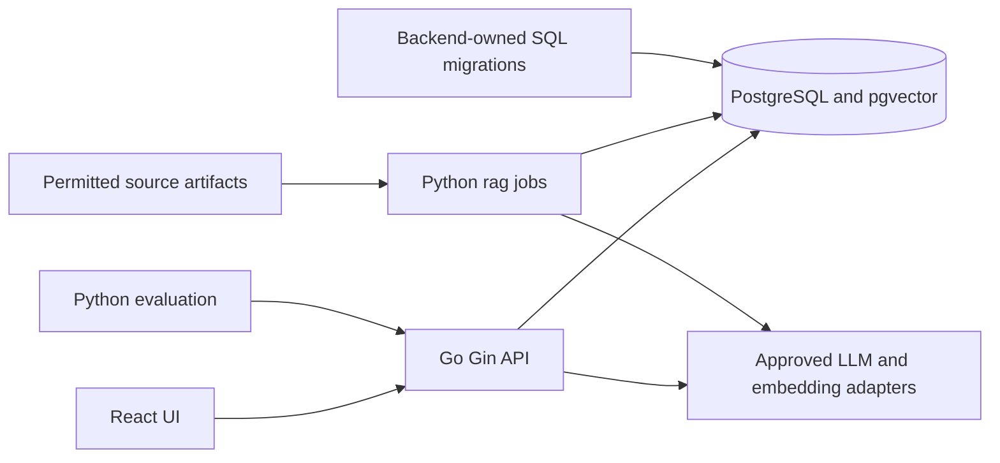

# KCA Technical Design

Implementation decisions supporting the [roadmap](../plans/implementation-plan.md). [Requirements](requirements.md) are the product authority; this document defines shared implementation rules once, and tasks reference them. Detailed code organization, signatures and commands are chosen when each task starts. Acquisition evidence and permission decisions belong in the [source-access record](discovery/source-access.md).

## 1. Architecture and ownership

| Boundary | Owner and responsibility |
|---|---|
| `backend/` | Go + Gin online API/business logic: authentication, profiles, filtering, deterministic curriculum predicates, intent/privacy projection, online retrieval, ranking and recommendation orchestration. Thin handlers call services/repositories. |
| `rag/` | Finite Python jobs: permitted ingestion, HTML/PDF parsing, assessment candidates, normalized academic publication, Markdown, chunking, corpus embeddings and retrieval evaluation. No personal-table access, permanent API, per-request Python subprocess or duplicated eligibility engine. Top-level `ingestion/` is not used. |
| `frontend/` | React + TypeScript + Vite; presentation, explicit edits/confirmations and in-memory conversation state. Backend remains authoritative. |
| PostgreSQL 16 + pgvector | Shared structured facts, rule versions, identity/profile data and revision-bound vectors, with separate runtime privileges. |
| Migration authority | Backend-owned zero-padded SQL history in `backend/db/migrations/`, executed explicitly through golang-migrate before affected runtimes use it. Neither runtime auto-migrates; sqlc generates query code and does not execute DDL. No second ORM/Alembic schema authority. |

Online flow: authenticate → load current profile → validate/clarify intent → apply hard filters and reviewed rules → optional semantic ranking → source-backed response. Offline flow: acquire permitted bytes → parse/normalize → review/publication → Markdown/chunks → corpus vectors → evaluation. Extracting a curriculum passage does not authorize its rule or evaluate a student's eligibility.

**Data access choice:** pgx/v5 + sqlc keeps timetable EXISTS/NOT EXISTS joins, effective/cohort windows, owner predicates, evidence revisions and vector SQL inspectable and typed. GORM supports raw SQL and simplifies CRUD, but combining ORM behavior with the required explicit queries adds little here; pgx alone adds handwritten scans/types. Use one approach. If sqlc demonstrably cannot type a vector expression, isolate fixed parameterized pgx SQL behind a typed adapter and integration test; do not introduce another ORM or interpolate user SQL. Review generated code without hand-editing it.

**Other choices:** Python 3.12, Pydantic artifact validation, psycopg writes, pytest, source-dependent BeautifulSoup/PDF adapters; Go standard context/httptest and exact decimals; frontend component/E2E tests. Selectolax, browser automation or OCR requires measured/source-layout need and permitted access. Managed OIDC, a dedicated vector DB, queues and Kubernetes add unnecessary pilot operations. Pin supported compatible tools/images when introduced. Go UUIDs use `google/uuid`, repository mappings may use pgtype; prevent Go import cycles by keeping orchestration above feature services.

**Compatibility and roles:**

- First migration creates the contract registry; academic contracts/tables arrive later. Canonical SQL is the database truth. Versioned catalog/evidence, embedding and reviewed-rule JSON schemas plus OpenAPI live under `docs/contracts/` when implemented; these are wire/artifact contracts, not a second DDL schema. Frontend types derive from OpenAPI; Go and Python validate their respective boundaries.
- `schema_contracts(name, version, fingerprint)` identifies immutable published artifact contracts. Fingerprints do not hash every DDL byte; additive SQL or identity-only migrations do not invalidate an unchanged academic contract. Changed artifact contracts publish supported versions; incompatible readers/writers fail clearly. Readiness checks connectivity first and required schema compatibility once migrations are introduced.
- Migrator owns DDL/roles/extensions. API reads academic data and performs only required personal/session writes with server-derived owner predicates. RAG writer writes source/catalog/evidence/chunk/vector/sync tables, with no identity/profile/session/credit/deletion or DDL access. Restricted admin imports reviewed rules and runs privacy maintenance.
- Publish one offering revision and its evidence/assessment atomically; Go owns personal/rule transactions. Test Python-write/Go-read compatibility on the same disposable PostgreSQL instance, not SQLite: UUID, Japanese text, UTC timestamps, decimal/null values, evidence references and later vectors/codecs/model metadata.

References: [sqlc with pgx](https://docs.sqlc.dev/en/latest/guides/using-go-and-pgx.html), [sqlc migration inputs](https://docs.sqlc.dev/en/latest/howto/ddl.html), [type overrides](https://docs.sqlc.dev/en/latest/howto/overrides.html), [GORM SQL builder](https://gorm.io/docs/sql_builder.html), [Gin](https://gin-gonic.com/en/docs/), [pgvector Go integration](https://github.com/pgvector/pgvector-go). Verify current APIs at implementation time.

## 2. Data model and artifact contracts

Raw artifacts, normalized SQL records, Markdown and vectors remain separate. Preserve original URL/document/page ID if available, year evidence, acquisition time, optional source-update time, raw excerpt, encoding/hash and parser/method version. Retain original bytes only where permitted; derivatives do not replace official sources. Missing source year/identity is quarantined before publication; source absence is not extraction failure or a fabricated value.

Use internal UUIDs and UTC `timestamptz`; exact numeric credits and nullable unknowns. UTF-8 at API/artifact boundaries; preserve original legacy bytes for reprocessing. The canonical academic model is:

| Table | Fields and integrity |
|---|---|
| `sources` | `id`, `url`, `kind`, `access_status`, `rights_notes`, `checked_at`; allowlisted official origins only. |
| `source_revisions` | `id`, `source_id FK`, `source_document_id?`, `sha256`, `fetched_at`, `source_updated_at?`, `academic_year?`, `encoding`, `artifact_path?`, `parser_version`, `status`; unique `(source_id,sha256,parser_version)`. Unknown source year quarantines course publication. |
| `evidence` | `id`, `revision_id FK`, `locator` (HTML heading/selector or PDF page/region), `excerpt`, `excerpt_sha256`; excerpts are immutable. Field-level `entity_evidence(entity_type,entity_id,field,evidence_id)` maps facts to evidence. |
| `courses` | `id`, `institution`, `source_catalog_key?`; stable academic identity only when source equivalence is verified. Titles are revisioned on offerings. No title-based automatic merging. |
| `offerings` | `id`, `course_id FK`, `source_offering_key`, `academic_year`, `term_code`, `section_key`, `active_revision_id FK`, `status`; unique `(source_offering_key,academic_year,term_code,section_key)` scoped to source. |
| `offering_revisions` | `id`, `offering_id FK`, `source_revision_id FK`, `title_ja?`, `title_en?`, `faculty?`, `department?`, `course_type?`, `credits?`, `syllabus_text?`, `objectives?`, `prerequisites_text?`, `assessment_text?`, `schedule_complete`, `restriction_status`; immutable published snapshot. |
| `offering_instructors` | `(offering_revision_id FK,ordinal)`, `name`, `affiliation?`; no assumption of a single instructor. |
| `meetings` | `id`, `offering_revision_id FK`, `kind=regular/intensive/irregular/unknown`, `weekday?` (ISO 1–7), `period_start?`, `period_end?`, `date_start?`, `date_end?`, `campus?`, `location?`, `raw_text`, `evidence_id`; multiple rows per offering. |
| `offering_restrictions` | `id`, `offering_revision_id FK`, `kind=affiliation/year/level/prerequisite/exclusion`, `predicate jsonb`, `evidence_id`; absence is unrestricted only when the source explicitly establishes completeness. |
| `assessments` | Offering revision FK, candidate value, effective `exam_required`, review status, original text/evidence, confidence, method/review metadata; lifecycle and constraints are defined in §3. |
| `curriculum_versions` | `id`, `faculty`, `department`, `track?`, `cohort_from`, `cohort_to`, `valid_from_year`, `valid_to_year?`, `source_revision_id FK`, `review_status`; overlapping applicable accepted versions cause `unverified`, never latest-wins. |
| `curriculum_rules` | `id`, `version_id FK`, `kind`, `predicate jsonb`, `category?`, `minimum_credits?`, `evidence_id`, `review_status`; whitelist predicate operators, no executable expressions. |
| `rule_courses` | `(rule_id FK,course_id FK)`, `mapping_kind`; reviewed course identity mapping, no fuzzy-title eligibility. |
| `period_definitions` | scope/year + period key, local start/end, `evidence_id`; Asia/Tokyo times, versioned by source revision. |
| `chunks` | `id`, owner offering/rule revision FK (exactly one), `section`, `ordinal`, `text`, `text_sha256`, `evidence_id`, `language`, `academic_year`; no cross-offering chunks. |
| `embedding_models`, `embeddings` | Model key/revision/dimension/distance/preprocessing; `(chunk_id,model_id)` unique, vector dimension validated. Separate namespaces for differing models; never compare incompatible spaces. |
| `sync_runs`, `sync_items` | Scope, completeness, start/end, counts, failures, source key, old/new revision, action and reason; one transaction per offering publish. |

Identity/profile storage is separate from academic content:

| Table | Fields and integrity |
|---|---|
| `users` | UUID, preserved email display form, canonical unique email key, password hash, verified/created/updated times. |
| `auth_sessions`, `auth_action_tokens`, `auth_rate_limits` | Owner FK/digest/expiry/action/window/recent-auth fields; policy and retention in §5. |
| `faculties`, `departments`, `academic_tracks` | Stable codes/localized labels/active flags, department→faculty and track→department relationships; independent of course-corpus coverage. |
| `student_profiles` | User PK/FK, nullable draft academic fields, optional track, three independent summary amounts/report timestamps/provenance, revision, created/updated times; rules in §6. Composite relationships enforce valid affiliation/track combinations. |
| `curriculum_credit_categories` | Category/version composite key, stable code/localized label/optional parent; unique code per curriculum version. |
| `profile_credit_reports` | User, curriculum-version/category composite FK, exact amount, reported time, self-reported provenance; unique owner/version/category. |
| `personal_data_deletions` | Only opaque owner UUID, profile/account scope and timestamp; restricted ledger semantics in §5. |

Stable course identity requires verified source equivalence; an offering is a specific year/term/section, with immutable revisions and a current accepted revision pointer. Never merge by title, instructor or repeated URL alone. If source IDs are absent, use a reviewed manifest-to-internal-ID mapping and reconcile reacquisition before upsert. Academic evidence rows are immutable, tied to source revision/locator/excerpt/hash, and linked to individual facts; conflicts remain visible.

**Publication/update policy:** scope-locked, operator-triggered export refresh by default; a proposed weekly schedule needs permission and known update patterns. Hash changes trigger reparse; parser/model changes invalidate affected derivatives. Preserve history/audit reasons; publish only complete atomic revisions. Partial/failed sync never withdraws records. A complete authoritative inventory can mark an offering suspected missing; two complete inventories plus operator confirmation can tombstone it. Explicit official cancellation immediately withdraws it. No automatic permanent purge. Serving uses the active accepted revision; changed evidence requires reassessment and rebuild rather than carrying forward an old conclusion/vector.

**Indexes:** begin with offering year/term/status, meeting day/period/revision, effective assessment state, rule scope/effective windows and frequent FKs; inspect actual plans before adding indexes. Exact vector search is sufficient initially. No approximate index without recall/performance evidence.

**Parsing/artifacts:** manifests include permission flags, original URL/year/time, optional update/document ID, byte encoding, local hash/path and parser version. Preserve multiple instructors, meetings/period ranges, irregular/intensive schedules, campuses, objectives/prerequisites/grading text and all source-present fields. Markdown retains Japanese headings/tables and evidence locators; PDF references include printed page and PDF index. Undecodable, corrupted, image-only or unsupported layouts require review. Pydantic/catalog contract validation does not fill missing facts.

## 3. Assessment evidence lifecycle

Store `candidate_exam_required` separately from effective `exam_required`; both use `yes/no/unknown`. Extraction emits a candidate plus original text/evidence, confidence (0..1), method version and `review_status=pending` (review states: pending/accepted/conflict). Confidence is a heuristic, not a probability or an acceptance decision.

| State | Effective value used by search |
|---|---|
| Extracted candidate `no`, pending review | `unknown`; excluded from strict no-exam results. |
| Candidate `yes` or `unknown`, pending review | `unknown`; display original grading and review uncertainty, not a confirmed fact. |
| Accepted, supported `yes` or `no` | Accepted value with evidence tied to the current offering revision. Human acceptance is mandatory for `no`. |
| Accepted unknown, conflict, rejected/unsupported evidence, or new revision awaiting reassessment | `unknown`; prior acceptance remains historical only. |

Acceptance requires the evidence locator/excerpt, source revision and review decision/time; an accepted value cannot disagree with the reviewed evidence. A course may be published with unknown assessment; publication alone does not accept its candidate. Strict no-exam SQL requires effective `exam_required=no`, accepted review and supporting current evidence together. Never filter on the candidate or confidence alone. Acceptance never implies the source itself is an official registration guarantee.

Explicit absence of all exams can produce candidate `no`; explicitly required written/oral/in-class exams produce candidate `yes`. Silence, `レポート100%` alone, optional/conditional exams or “no final exam” with ambiguous quizzes produce `unknown` pending review. `期末試験なし。小テストあり。` must never be treated as confirmed no-exam; classify a clearly required exam as yes or leave ambiguous quizzes unknown. Conflicting sources force effective unknown. Review fixtures must exercise candidate-no pending, accepted-no, revoked acceptance and changed/conflicting source text independently.

## 4. Search, rules and response behavior

### Intent and deterministic selection

The full `SearchIntent` object has all keys below present; unknown extracted scalars are null, with no year inferred from today's date. `IntentPatch` uses omitted=retain and explicit null=clear; supplied topics replace previous topics. Reject extra keys and all model authorization/persistence fields.

| Fields | Contract |
|---|---|
| `language` | ja/zh/en. |
| `academic_year`, `term` | Offering scope; nullable until clarified, validated against acquired catalog. |
| `faculty`, `department`, `track`, `student_year`, `admission_cohort` | Student academic context, interpreted through §§6–7; year of study ≥1, not an owning-department course filter. |
| `weekday`, `period`, `period_phrase` | ISO weekday 1–7, period ≥1, optional unresolved wording; validate actual period definitions. |
| `schedule_mode` | `contains_slot` or `fits_available_slots`. Initial available-slot UI supports one slot. |
| `exam_required` | null=no preference; yes/no requires confirmed matching value; unknown explicitly browses unclear grading. |
| `topics`, `curriculum_category`, `limit` | At most 10 topic strings, optional category, result limit 1–10. |

Clarify only missing material search year/term, unresolved period or rule-critical optional track; do not ask again for saved profile fields. Alias maps support Japanese/Chinese/English affiliation/term wording; unknown aliases require clarification. Unsupported corpus scope yields a coverage warning, not substitution of another year/department. Missing official timing must not silently map “first afternoon class” to period 3.

Use parameterized structured queries for term/year/dates, same-meeting weekday+period, period ranges, affiliation/year/level/prerequisite restrictions and effective assessments. `contains_slot` requires a known matching meeting and prominently shows additional meetings. `fits_available_slots` requires the entire known schedule to fit; any additional or unknown required meeting fails. Intensive/irregular/null schedules are not ordinary confirmed slots. Unknown explicit hard restrictions cannot establish a strict match; show needs-confirmation separately. Missing restriction rows imply unrestricted only if source completeness is verified. Hard failures are removed before ranking and rechecked on serialization; no automatic relaxation on empty results.

### Curriculum predicates

Resolve exact course/category mappings by faculty, department, admission cohort, optional track and offering year/effective dates. Required/elective status, credit minima, level constraints, prerequisites, exclusions and substitutions are versioned reviewed predicates with source evidence. Whitelist `all/any/not/equals/in/gte/lte`, with three-valued logic; never execute stored expressions or fuzzy-title eligibility mappings.

`eligible` means the specific requested predicate is established by accepted applicable rules; `ineligible` means an applicable predicate is false; `unverified` covers absent facts/history, missing/overlapping versions, essential track ambiguity, conflict or unsupported operators. Taxonomy membership alone is not rule evidence. Explain aggregate credit requirements but do not compute completion without the actual verified history outside MVP. For strict verified-category requests, unverified cannot match; ordinary discovery may include it with that label. LLM/RAG passages explain/cite predicates but cannot decide or override them.

### Retrieval, ranking and citations

Go calls the selected query-embedding provider directly; Python corpus jobs use the same provider/model/revision/dimension/distance/tokenizer/normalization and query-passage preprocessing manifest. Equal dimensions alone do not prove compatibility. No live Python service/subprocess. Hosted processing requires source/data terms approval; if unavailable, structured development continues while semantic launch remains blocked. Local multilingual-e5-small/BGE-M3 are offline challengers until compatible Go inference is validated separately.

Start section chunks at 300 model tokens with 40-token overlap, bounded by verified model limits. Chunks stay inside one offering/rule revision with section/ordinal, text/hash, language/year and evidence. Only deidentified topic text is query-embedded; no account/profile/credit vectors. Exact cosine retrieval is restricted to current hard candidates; aggregate maximum chunk score per offering to avoid duplicates. Rule passages use the same applicable scope. Model mismatch, stale revisions and partial embedding coverage fail clearly or warn; never substitute an old model/revision. Empty topics skip embedding calls. Register codecs on every pgx connection and verify Python/Go distances within documented floating tolerance.

Rank lexicographically: hard satisfaction first (by exclusion), verified requested curriculum relevance, semantic relevance, soft preferences, stable offering ID. Responses include intent/clarification, coverage/snapshot warning, profile revision, hypothetical/proposed-override fields and recommendation cards. Every card has course name, all known meetings, grading original text, curriculum status, reasons, syllabus URL, evidence/excerpts and warnings; unknowns display 未確認. Evidence includes original URL, locator/page, year, fetched_at and optional source_updated_at. Only active accepted evidence IDs may support claims; excerpt display follows source rights.

Facts come from stored fields. Optional generated prose is restricted to validated offering/evidence IDs and supported claims; reject fabricated/altered facts and use templates on generation failure. Treat source text as untrusted instructions; no query-time crawling/browsing. Comparison accepts only current acquired IDs and covers schedule, grading, prerequisites and curriculum status. Preserve explicit constraints across language changes and follow-ups. Clearly qualify recommendations as decision support, not official academic guidance.

**Worked example:** the specified Japanese/Chinese “third-year 地球工学科, Wednesday first afternoon class, no exam” request loads the stored cohort/affiliation. Ask for missing offering year/term and unverified period mapping; contradictory academic context follows §7. After an explicit AY2026 second-semester Wed3, all-meetings-fit clarification, a synthetic A at Wed3 with accepted no-exam evidence can match; B with candidate-no pending cannot; C at Wed3+Fri2 fails fit; D with accepted exam yes fails. Without applicable reviewed rules, A's curriculum status is unverified. No topic means no vector call. Real output needs a real permitted matching course; otherwise return an honest no-result with sample coverage, and retain constraints on an environmental-topic follow-up.

## 5. Authentication and personal-data security

Use Go email/password authentication with a maintained Argon2id PHC-format wrapper (alexedwards/argon2id over x/crypto/argon2); review/pin maintenance, parameters and hashing resource bounds when implemented. Do not implement cryptographic primitives, store plaintext passwords, assume university SSO, require student IDs, or treat email as university-membership proof. Personal repositories derive ownership from authenticated server principals, not client IDs; no cross-user profile route or serialization of principal/session digests. Personal responses use `Cache-Control: no-store`.

- **Passwords/email:** 15–128 characters, Unicode/spaces allowed, no truncation/composition rules; trimmed case-insensitive canonical email key with preserved display form and uniqueness. Invalid/absent users get generic 401 with dummy-hash work. Registration/recovery requests use generic non-enumerating 202; duplicates do not disclose accounts.
- **Sessions:** 32 random token bytes, only SHA-256 digest and owner stored; absolute 7-day lifetime, no automatic extension, expiry checked every use. Rotate on login/reauthentication; revoke on logout, reset and account deletion; operator cleanup removes expired rows. Two-user/restart/replay tests use real cookie/session guards.
- **Cookies:** hosted `__Host-kca_session`, HttpOnly, Secure, SameSite=Lax, Path=/, no Domain. Local HTTP uses separately named `kca_session` only in explicit development mode. No browser-readable bearer/localStorage tokens.
- **CSRF/Origin:** same-origin proxy; unsafe requests require allowed Origin and JSON content type, including pre-session register/login/recovery. Authenticated writes additionally require session-bound `X-CSRF-Token`, obtained from the session endpoint. Derive token via HMAC-SHA256(AUTH_HMAC_KEY, `csrf:` + raw session token), store its SHA-256 digest, compare constant-time, rederive when requested and rotate with sessions. Refresh the client token after rotation. Never permit arbitrary credentialed CORS origins.
- **Limits:** 5 failed login attempts per canonical email key /15 min and 20 per IP /15 min; registration/recovery 5 per IP /hour; return 429 with Retry-After. Use atomic PostgreSQL counters with expiring HMAC-derived keys, not raw email/IP telemetry or in-memory-only multi-worker limits.
- **Verification/reset:** 32 random action-token bytes, hashed and atomically consumed once; verification expires in 24 h, recovery in 30 min. Invalid/used/expired tokens fail. Verification creates no session; reset revokes all sessions. Local fake mail sends nothing; public launch requires working transactional mail, HTTPS and verified email before personalized access.
- **Recent auth/deletion:** password reauthentication within 5 min for profile/account deletion. Profile-only deletion removes summaries/reports, resets to incomplete onboarding and revokes sessions; next login returns to onboarding. Account deletion transactionally erases account/credentials/sessions/actions/profile/credits without touching another user or the public catalog. Prevent concurrent edits resurrecting deleted rows. Clear frontend personal/conversation state on logout/expiry/deletion/account change.
- **Backups:** encrypted backups expire within a maximum 30-day window. Transactional restricted deletion markers contain only opaque owner ID, profile/account scope and time; serving can append but not read maintenance ledger, RAG cannot access it. Replay deletions after the backup snapshot before traffic resumes, then expire markers only when every eligible backup has expired. Scope/time handling must not delete a legitimate replacement profile from a newer compliant snapshot. Never promise instantaneous erasure from retained backups.

## 6. Profile and credit semantics

Create an empty profile draft at registration. Faculty, department, grade and enrollment year are required for personalized access; track and all credits are optional/skippable and editable later. Grade means year of study (integer 1–10 technical bound); enrollment year is admission cohort (1900 through current Asia/Tokyo calendar year); offering year is independent. Never infer one from another or automatically increment grade/guess track. Stable taxonomy codes map profile IDs to rule context; validate faculty/department/track relationships independently of acquired course/rule coverage.

Fresh server profile values are academic defaults on every personalized request. Explicit saved edits use the profile-management API with authenticated owner, CSRF and `expected_revision`; revision conflict is 409 and changes are atomic. Omitted patch fields retain values; null clears fields, including required fields back to incomplete onboarding. Reject unknown/read-only/owner keys, duplicate category keys and invalid relationships with whole-patch rollback. Profile view returns revision/completion state, warnings and credit provenance/timestamps.

Three independent optional summary amounts—`total_earned_credits`, `major_earned_credits`, `general_education_earned_credits`—can be saved without any curriculum rules or category IDs. Label them `self_reported` with individual server report timestamps, reset on clearing; edits persist across restarts. Exact hundredths/int64 in Go, Decimal in Python and NUMERIC(7,2) in SQL; accept 0–99,999.99, at most two decimal places, reject negatives/nonfinite/overflow. JSON numbers are parsed from exact decimal representation, never float64. Null means unreported, zero reported zero, omission unchanged.

Optional curriculum category reports are separate owner/version/category records with amount, timestamp and self-reported provenance; categories are available only for a uniquely applicable reviewed version. Null clears that report; omitted reports remain. Reject scope mismatches; preserve reports under original version after affiliation/track changes, mark them inactive outside that scope and reuse only upon return to it. Warn that summaries may need review after an affiliation change; never relabel them as official categories.

Summaries/category reports may overlap: do not sum them or force subtotals to equal total unless an applicable verified rule defines that relationship. Neither self-reports nor reviewed category definitions establish officially validated progress, prerequisite/exclusion completion or graduation eligibility. No transcripts/student IDs/completed-course audits are required in MVP; lacking history leaves completion unknown. Missing rules do not block profile/summary storage. An essential optional track may leave category evaluation unverified, without blocking ordinary discovery.

## 7. API and temporary profile overrides

### Wire and endpoint contract

OpenAPI defines wire shapes; generated TypeScript types and explicitly validated Go DTOs must agree. Reject unknown fields, enforce body/enums/ranges and preserve omitted/null/value (e.g. a presence wrapper). UUIDs use application UUID types with explicit repository conversion; RFC3339 UTC timestamps at boundaries. Backend port stays 8000; `/docs` exposes a static/generated OpenAPI viewer.

| Route group | Contract |
|---|---|
| Public | GET `/health` → 200 `{"status":"ok"}` independent of DB; GET `/ready` → 200 or 503 connectivity/required-version status; GET `/api/scope`, `/api/offerings/{id}`, `/api/evidence/{id}` → coverage/detail/permitted evidence or 404. Never expose arbitrary paths/raw HTML. |
| Personalized | POST `/api/search` and `/api/chat` require session, CSRF, completed profile and current profile revision; typed search skips LLM parsing. No anonymous personalized fallback, including during outages. |
| Identity | POST `/api/auth/register`, `/login`, `/logout`, `/verification-request`, `/password-reset-request`, `/verify-email`, `/password-reset`, `/reauthenticate`; GET `/api/auth/session` (all under `/api/auth`); policy in §5. |
| Profile | GET/PATCH/DELETE `/api/me/profile`, DELETE `/api/me/account`; GET `/api/profile-options` with optional department/cohort/offering-year/track selectors. Incomplete profiles can view/edit and retrieve taxonomy/options. Deletions require recent auth; no input owner ID. |
| Feedback | POST `/api/feedback` → 204 for helpful/irrelevant/source_issue plus optional known offering ID; aggregate only, no message/profile/free text. Same-origin/JSON enforcement; authenticated requests use CSRF. |

Registration/login use `{email,password}`; login returns `SessionView` and rotated cookie, session GET returns authenticated/email_verified/onboarding_complete/CSRF fields, 401 when absent/expired. Verification/reset requests take email; verify takes token; reset takes token/new_password; reauthentication takes password and rotates session, returning 204. Logout revokes/expires cookie and returns 204; a repeat valid-origin request with an already expired cookie is also 204. Profile PATCH includes `expected_revision`, academic/summary fields and optional versioned reports; GET returns completion/revision/provenance/warnings. Successful deletion/verification/reset actions return 204; invalid action tokens 400.

General status contract: 200 for valid response/clarification/no-result; 401 invalid/expired session; 403 CSRF or `reauthentication_required`; 409 `onboarding_required` or `profile_changed`/edit revision conflict; 422 malformed/invalid data; 429 rate limits; 503 DB/unavailable-provider retry guidance. These failures never bypass access or silently relax academic constraints.

### Temporary overrides

Search and chat carry `profile_revision` and optional `temporary_profile_override: {values, confirmed}`. Values contain only nonempty academic patches: faculty, department, student_year, admission_cohort, optional track; omit=retain saved value and null can clear only optional track. Validate merged scope/bounds. `confirmed` defaults false and belongs only to the explicit client envelope, never model-output intent. No owner IDs, credits, credentials or persistence flag are allowed.

Precedence: fresh saved defaults → exact current-revision client-confirmed temporary values → current nonacademic filters. Missing/false confirmation for divergent academic intent returns 200 clarification plus `proposed_profile_override` and no recommendations. UI reviews exact values, then resends confirmed=true at the current revision. Model text/previous intent cannot authorize divergence or persistence. Continue a hypothetical conversation only by explicitly resending the confirmed values; omit the override to restore saved defaults. Label applied context/cards hypothetical; it never completes onboarding or changes ownership/profile/credits/revision. Only authenticated profile-management endpoints in §6 persist changes.

Responses include current `profile_revision` (internal pre-profile tests may use null), `hypothetical`, optional proposed override and resolved intent/clarification. Stale revision returns 409 `profile_changed` before override application; reload profile, discard cached academic context/overrides and retain unrelated schedule/topic filters for review. Refresh profile on focus/edit/conflict; clear personal context on auth loss/account switch. Comparison selection is at most 10 current offering UUIDs; chat message at most 2,000 characters. `previous_intent` is revalidated, not a trusted owner/context claim.

### Frontend behavior

Bootstrap session then profile through one cookie/CSRF-aware same-origin client. Required-field onboarding gates both UI and API; an unverified/missing rule-critical optional track is a separate clarification. Build authenticated browser fixtures before feature E2E and full form journeys later. Keep messages/filter state in memory, not persistent browser storage. Show Japanese labels first with optional Chinese/English, exact decimal validation, optional progress Skip, explicit profile saves and revision conflicts retaining unsaved edits. A faculty change clears incompatible dependent selections for review in one atomic patch. Course UI covers loading/error/empty/clarification/coverage states, accessible labels/keyboard actions, comparisons and source excerpts rendered as text.

## 8. Provider privacy and operations

**LLM academic allowlist:** only needed faculty/department codes/names, grade, enrollment cohort, optional track and requested offering year/term. Credits are excluded by default; an explicit credit/progress request permits only the requested total/major/general summary or relevant category amount with self_reported/unverified provenance. Include hypothetical label when applicable. No full profile, account/student identifiers, email, passwords, tokens, unnecessary personal information or authorization fields.

Project on the server; minimize structured input and free-text/prior context before provider calls, removing identity/secrets and unrequested credit information. If safe minimization cannot produce a useful request, ask for reformulation without calling a provider. User wording alone does not authorize persistent writes. Test both payload forms and withheld-call behavior. Identity/profile/credits/raw chats never enter logs, analytics, shared caches or embeddings; source excerpts are excluded from telemetry and personal caches, while permitted academic chunks may be embedded under §4; no personal response cache keys or durable chat store. Ingestion never receives student context. Deidentified topic embedding follows §4.

Use one provider-neutral Go LLM adapter and one shared-compatible embedding model; fake adapters in ordinary tests. Do not infer AWS/provider choice from empty env placeholders. Prefer one intent call and deterministic answers; optional prose/reranking requires measured benefit. Python evaluation calls guarded Go APIs with disposable synthetic accounts or exported responses; it compares gold results, not reimplements eligibility/filtering.

Config separates API database, RAG writer, migrator and restricted maintenance credentials. Examples: `DATABASE_URL`, `RAG_DATABASE_URL`, `MIGRATION_DATABASE_URL`, `ADMIN_DATABASE_URL`; only inject each runtime's needed names. Add origin/cookie/development/HMAC/mail/provider/model/artifact/scope/log settings when needed; secrets stay in env/secret management, not commits/images/resolved-config output. Context/deadlines bound DB/provider work; sanitize errors and close resources.

Observability covers sync failures/audit, extraction coverage, accepted/pending/unknown assessment counts, rule unknown/conflict outcomes, candidate/result counts, SQL/retrieval/LLM latency, model/tokens/aggregate cost and fixed-category user feedback, without personal content.

## 9. Verification and release gates

Use independent field/assessment/rule labels on a frozen permitted source snapshot. Engineering fixtures and fake-provider results are reported separately from real extraction, model and recommendation quality. Record numerators/denominators, human label disagreements, hardware/model/provider and cold/warm behavior. Missing applicable data makes a gate unmeasurable, not passed.

Prepare 40 realistic questions within the required 30–50 range: 20 Japanese/10 Chinese/10 English, split 20 development/20 held-out with balanced language/behavior, including 8 no-result and 8 clarification cases. Equivalent paraphrases stay in the same split. Gold offering/page/evidence IDs belong to a frozen snapshot; changed sources require relabeling, not automatic expected-result updates.

| Area | Measurement and gate |
|---|---|
| Extraction | URL/year/fetched time/evidence coverage 100% of published records; source-present title/meeting/assessment extraction coverage ≥95% on human-labeled fields. Report source absence separately; do not increase coverage by guessing. |
| Exam classification | Confirmed `no` precision 100% on pilot labels; report yes/no precision/recall, unknown rate and accepted/pending counts. No arbitrary unknown-rate target that pressures guessing. If no real `no` labels exist, precision is not measurable and that release claim remains unsupported. |
| Strict filters | Precision and recall 100% against deterministic expected sets for day/period/term/year/no-exam on frozen corpus, including multiple meetings/ranges/irregular schedules and nulls. Candidate set is independent of semantic ranking. |
| Curriculum | Expected status and scope/citation correctness 100% for reviewed supported predicates and negative/unknown cases; no graduation completion assertions. Cohort transitions, amendments, overlaps and absent histories tested independently from LLM. |
| Retrieval | Hit@5 ≥0.8 overall, ≥0.7 per language on answerable topic cases; report Recall@5, page/course IDs and small-group counts. For filter-only queries report set correctness instead of vector metrics. |
| Grounding | 100% referenced IDs resolve to active accepted evidence; 100% strict constraints satisfied; human checks every pilot recommendation's factual claims/citations. Measure unsupported claims separately from missing claims; no-result and clarification accuracy 100% on their labeled cases. |
| Conversation | Follow-up constraint retention and explicit overrides 100% on fixture cases, including Japanese→Chinese→English, comparison, invalid IDs and prompt-injection attempts. |
| Performance/cost | p95 structured ≤500 ms and chat ≤8 s at stated load; explicit timeout response by 10 s. Record model latency, SQL latency, embedding coverage, memory, token use and estimated monthly cost against proposed ceiling. |

Load definition: warm service, 5 concurrent users, at most 100 offerings, 100 requests per path. Include auth/profile lookup in p95; report hashing separately and cold starts/provider failures explicitly. Go race/integration checks, Python publication/vector/metric checks and authenticated frontend E2E precede final acceptance. Go/Python numeric ranking uses documented floating tolerance, not assumed exact provider bit equality; candidate containment, revision isolation and schema/model compatibility must be perfect.

Optional hybrid/rerank experiment: only after measured vector misses justify it, compare filtered vectors with filtered Japanese-tokenized BM25 + reciprocal-rank fusion, optionally reranking at most 20 candidates. Adopt only if held-out Hit@5 improves ≥0.05 absolute, no language regression exceeds 0.05, hard constraints remain perfect and p95/cost stay within budget. Verify/pin tokenizer/model docs; generic SQL keyword search does not establish Japanese segmentation quality.

Budget proposals: hosting ¥5,000/month plus inference ¥2,000/month, pending owner approval, not vendor quotes. At 1,000 chats/month budget up to 2,000 LLM calls and count query/corpus embedding rebuild costs separately inside the same inference ceiling. Measure actual tokens/latency/memory/resources/prices; no GPU/hosting commitment before approval and passing gates. Source access, semantic model quality, mail/HTTPS and privacy gates cannot be waived because an early structured milestone works.

## 10. Local environment and safe cutover

Introduce a minimal Go image and Compose database early, then grow it with the roadmap. Final topology: Go backend, PostgreSQL/pgvector, static frontend/same-origin proxy, explicit one-shot migrator and opt-in finite `rag` job image. Jobs have no listener/restart loop; Go image has no Python, RAG has no personal-data credentials. Use minimal pinned multi-stage builds, non-root users, health checks, local/production separation and localhost developer ports; hosted DB stays internal. Mount raw artifacts only where needed by jobs and exclude secrets/artifacts from images/Git.

Use the roadmap’s shared workflow for repository preflight; do not restore/discard unexplained edits or deletions. Preserve service port 8000, health JSON, readiness, `/docs`, root directories/Compose entry point and named database volume. Inspect existing data non-destructively before migration. FastAPI-only requirements/app files, Python Docker entrypoints and Uvicorn bind mounts are retirement candidates once Go parity and rollback are proven; do not move obsolete API dependencies wholesale into `rag/` or remove files simply to make a build pass.

Development smoke/DB resets and final restoration drills use a separate named disposable Compose project; never use `down -v` on existing resources. Finish runbooks for startup, explicit migration, permitted import/refresh, embedding rebuild, maintenance, encrypted backup/restore, deletion replay and schema-compatible rollback. Prefer compatible images/forward migrations; never blindly down-migrate identity data to roll back an image. A health-only legacy image is not a functional rollback for new account features. Review scaffold cleanup separately after parity. Production access/destructive operations and hosted deployment require explicit authorization and a concrete resource/cost/rights proposal.
