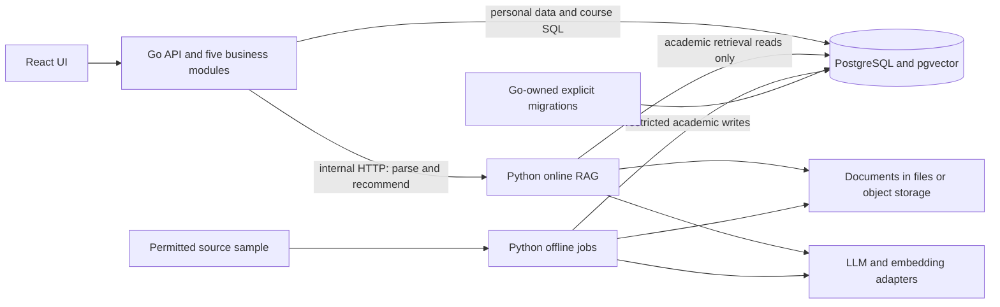

# KCA Technical Design

[Requirements](requirements.md) define product behavior; this document is the single authority for architecture, data permissions, interfaces and state. [The roadmap](../plans/implementation-plan.md) references these definitions. This is the target design, not a claim of implemented features. Acquisition evidence belongs in [source access](discovery/source-access.md).

## 1. Architecture and ownership

| Boundary | Responsibility |
|---|---|
| `frontend/` | React + TypeScript + Vite; registration, Profile setup/editing, single-query UI and database-backed cards through a same-origin Go API. |
| `backend/` | Go + Gin with pgx + sqlc. **Auth:** accounts/sessions/isolation. **Profile:** configuration and academic Profile. **Course:** metadata/SQL filtering. **Curriculum:** minimal reviewed handbook-applicability mappings. **Chat:** parse/filter/RAG orchestration and response validation. |
| `rag/` online | Python internal HTTP API: Instructor/LLM intent parsing, Profile-aware scoped retrieval, query embeddings, source reading and evidence-based recommendation ranking. No public account API or personal-table access. |
| `rag/` offline | Separate jobs for permitted acquisition, parsing, normalization, Markdown, chunks, embeddings, course summaries and publication/evaluation. No personal data. |
| PostgreSQL + pgvector | Shared storage with separate runtime grants, not identical access. Documents live in local files during development or object storage, linked by explicit identifiers. |
| Local Compose | Go, Python online, PostgreSQL/pgvector and frontend/same-origin development access; offline jobs run explicitly. Preserve the existing named database volume. |

Handlers, middleware, repositories and the internal RAG client are supporting layers, not additional business services. Defer StudyPlan. Curriculum is not a full predicate-based rule engine. Keep the root layout; no top-level `ingestion/`, extra microservices, Redis, queues, Kubernetes or complex agent orchestration.



Retain pgx + sqlc for explicit parameterized timetable/ownership queries and typed results. No replacement ORM is needed. Generated database structs remain separate from public DTOs. Python owns online vector operations; Go need not implement vector retrieval or query-embedding inference. Use Pydantic for artifacts and Instructor for structured model output; provider integration remains replaceable. Select parser adapters and pin compatible dependencies only when sample formats and implementation needs are known.

## 2. Affiliation configuration and Profile

This section is the **only authoritative affiliation/コース configuration list**. Names and relationships below are user-specified configuration requirements; official verification has not been completed. Codes are stable internal identifiers, independent of Japanese display labels. Initialization/administration maintained by the Go project owns this configuration.

`affiliation_type` is `undergraduate_faculty` or `graduate_school_division`. Every row has `code`, `display_name`, `affiliation_type` and `available`. Group these types in the UI; rows with `available=false` are disabled and labeled **“Not yet available.”** Only the enabled school is selectable. Backend validation enforces this, not just the UI.

| Code | Display name | affiliation_type | available |
|---|---|---|---|
| `ug_integrated_human` | 総合人間学部 | undergraduate_faculty | false |
| `ug_letters` | 文学部 | undergraduate_faculty | false |
| `ug_education` | 教育学部 | undergraduate_faculty | false |
| `ug_law` | 法学部 | undergraduate_faculty | false |
| `ug_economics` | 経済学部 | undergraduate_faculty | false |
| `ug_science` | 理学部 | undergraduate_faculty | false |
| `ug_medicine` | 医学部 | undergraduate_faculty | false |
| `ug_pharmacy` | 薬学部 | undergraduate_faculty | false |
| `ug_engineering` | 工学部 | undergraduate_faculty | false |
| `ug_agriculture` | 農学部 | undergraduate_faculty | false |
| `grad_letters` | 文学研究科 | graduate_school_division | false |
| `grad_education` | 教育学研究科 | graduate_school_division | false |
| `grad_law` | 法学研究科 | graduate_school_division | false |
| `grad_economics` | 経済学研究科 | graduate_school_division | false |
| `grad_science` | 理学研究科 | graduate_school_division | false |
| `grad_medicine` | 医学研究科 | graduate_school_division | false |
| `grad_pharmacy` | 薬学研究科 | graduate_school_division | false |
| `grad_engineering` | 工学研究科 | graduate_school_division | false |
| `grad_agriculture` | 農学研究科 | graduate_school_division | false |
| `grad_human_environment` | 人間・環境学研究科 | graduate_school_division | false |
| `grad_energy_science` | エネルギー科学研究科 | graduate_school_division | false |
| `grad_asian_african` | アジア・アフリカ地域研究研究科 | graduate_school_division | false |
| `grad_informatics` | 情報学研究科 | graduate_school_division | true |
| `grad_biostudies` | 生命科学研究科 | graduate_school_division | false |
| `grad_global_environment` | 地球環境学舎 | graduate_school_division | false |
| `grad_advanced_survival` | 総合生存学館 | graduate_school_division | false |
| `grad_public_policy` | 公共政策教育部 | graduate_school_division | false |
| `grad_management` | 経営管理教育部 | graduate_school_division | false |

Subdivisions use the display term **コース**. Each row below has parent `grad_informatics`, type `course` and `available=true`; the parent must also be available. Do not configure departments/tracks within other affiliations yet.

| Stable コース code | Display name |
|---|---|
| `inf_intelligence` | 知能情報学コース |
| `inf_social` | 社会情報学コース |
| `inf_advanced_mathematical` | 先端数理科学コース |
| `inf_applied_mathematics` | 数理工学コース |
| `inf_systems` | システム科学コース |
| `inf_communications` | 通信情報システムコース |
| `inf_data_science` | データ科学コース |

**Availability is not coverage:** maintain course-corpus scope/completeness separately from handbook coverage. A configured name does not enable service; an enabled コース does not establish verified academic coverage. Preconfiguration does not broaden v0 users or acquisition scope.

A v0 Profile stores `affiliation_code`, `course_code`, `degree_level=masters`, `year_of_study`, `admission_year`, plus owner/revision/timestamps. Academic fields may be absent in a draft; all are required for personalized discovery. Registration creates the account independently of setup. Do not add earned-credit summaries, category reports or completed-course history. Validate available parent/child codes, master's level and positive integral study year; admission year must be a valid nonfuture calendar year, without deriving the study year or offering scope from it.

Go resolves owner from the session, loads the latest Profile per query and supports GET/edit across devices. Edits use `expected_revision`; stale writes return 409 without partial changes. Omitted fields retain values; null clears to incomplete where permitted. Reject unknown/owner/read-only keys atomically. Profile editing is explicit: parsed request context never writes it. v0 introduces no hypothetical override/confirmation workflow; contradictory necessary academic context prompts the user to edit Profile or reformulate. The independent target is explicitly AY2026 `second_semester`, not inferred from admission year or current study year.

## 3. Database permissions and migrations

| Data | Writer | Online reader |
|---|---|---|
| Accounts, login sessions, Profiles | Go | Go only |
| Affiliation/コース definitions and availability configuration | Initialization or administration flow maintained by the Go project | Go |
| Course metadata, schedules, source metadata | Python offline ingestion | Go |
| Documents, chunks, embeddings, course-summary indexes | Python offline ingestion | Python online RAG |
| Reviewed handbook-applicability mappings | Ingestion after human confirmation | Go resolves scope; Python reads corresponding documents |

Go owns the only versioned SQL migration history under `backend/db/migrations/`. Run migrations explicitly before dependent runtimes use a new schema; neither runtime auto-migrates. No second Alembic/ORM authority. sqlc generates Go code from canonical SQL and does not execute migrations. Document concise wire/artifact versions alongside their owning tasks; fail clearly on incompatible readers/writers.

Use separate credentials: migrator (DDL/roles/extensions), Go API (personal/session writes, configuration and academic metadata/mapping reads), Go configuration administration (definition/availability writes), Python online (read-only documents/chunks/summary/vector and scoped handbook document access), Python offline (restricted academic writes after applicable review), and restricted privacy maintenance. Do not give Go serving credentials academic write or configuration-admin privileges. Neither Python role can access accounts, sessions, Profiles or deletion records; online Python cannot read relational course/schedule tables to repeat Go's filtering. It receives source/version metadata through compact candidates and its retrieval indexes. Go validates references through source metadata, including ingestion-published document/section/revision manifests; these metadata links are not document-body or vector access. Give runtimes only their own environment secrets and file/object-store permissions; offline jobs cannot obtain online student context.

Verify grants with allowed and denied operations on one disposable PostgreSQL instance. Python-produced metadata is tested through Go readers; Python-written vectors are tested through Python online readers. UUID, Japanese text, exact credits/nulls, timestamps, candidate/reference IDs and revision/model compatibility must round-trip. Do not invent a second schema just for tests.

## 4. Academic data and source artifacts

Keep this model small; finalize physical tables against permitted sample formats before implementation:

| Record | Essential content |
|---|---|
| Course | Stable `course_id`; source identity mapping only when equivalence is established. Never merge merely by title. |
| Offering | `offering_id`, `course_id`, source/section key, academic year/semester, revision/status. A specific offering is not the timeless course. |
| Metadata and meetings | Only source-present code, name, offering unit, year/semester, multiple meeting times, credits, instructors, teaching method, level, subject area, prerequisite text and source links. Unknown is nullable; all meetings are retained. |
| Source/document | `document_id`, source URL, source document key if present, retrieval/update times, encoding/hash, source revision, year/section, local path/object key and permitted-use record. |
| Retrieval records | `chunk_id`/summary ID, document and offering or handbook scope, section/locator, source revision, text/hash and model/version/dimension/preprocessing metadata for vectors. |
| Handbook mapping | School/コース/degree/admission-year range → reviewed document/section IDs and applicable edition/effective scope, confirmation record and source references. |

Credits are exact decimal course facts (SQL numeric, exact Go representation, Python Decimal; JSON decimal strings such as `"2.0"`), not earned-credit storage. Preserve missing versus zero. Store original bytes where permitted, normalized records, Markdown and embeddings separately; documents in local files/object storage have explicit document/index links. Source-present assessment and detailed curriculum provisions remain in syllabus/handbook documents. v0 requires no `exam_required` table, assessment-review state machine, full category mapping or predicate DSL.

Publish per-offering revisions atomically; reruns are idempotent, with stable source mappings, hashes and audit counts. A changed document invalidates its summaries/chunks/vectors and prior evidence conclusions. Never mix sections/semesters or reuse stale derivatives. Partial/failed ingestion must not withdraw prior offerings; confirm withdrawal/cancellation from authoritative evidence. Missing year/identity prevents publication rather than being guessed. Start with operator-run refresh; choose cadence and larger collection only after permission and sample validation.

Preserve Japanese encoding/headings/tables, PDF file/printed page locators and original URLs. Conflicting sources remain visible as unresolved. Minimal source/evidence traceability is mandatory; complex general review machinery is not. Exact vector search is adequate initially; add approximate/hybrid machinery only when measurements justify it.

Handbook resolution is a Go lookup of manually reviewed applicability mappings, using current school/コース/degree/admission year and any documented offering-year scope. Missing/overlapping mappings produce `missing`/`ambiguous` coverage, not newest-edition guessing. Go sends only resolved document/section IDs to Python. Missing coverage allows basic discovery but cannot establish curriculum alignment or course-category fulfillment.

## 5. Online recommendation flow

1. **Go authenticates** and loads the latest completed Profile and explicit target semester. Project the minimal academic allowlist and sanitize free text before any Python/provider call.
2. **Python parses** through Instructor/LLM with Profile present from this first step: supported structured filters, semantic needs, must/prefer conditions and unresolved requirements. A normal request uses one generative call here.
3. **Go validates** field enums/types and must/prefer semantics; resolves phrases such as “first afternoon class” against verified applicable period definitions, or returns clarification. Map supported conditions to parameterized sqlc SQL. Never execute SQL generated by the model. Do not drop unsupported must conditions silently; evidence-checkable ones proceed to source evaluation, others require clarification.
4. **Go sends SQL candidate offering IDs and compact metadata**, necessary academic context, reviewed handbook scope and the interpreted request to Python. No complete syllabus documents cross from Go. Preserve the entire SQL candidate scope before personalized selection, subject to an explicit transport bound; if oversized, request clarification rather than keeping an arbitrary first N. Profile relevance alone is not offering-unit equality.
5. **Python selects a limited inspection batch within those IDs** using Profile, interpreted needs and available scoped handbook/summary information, then uses vector retrieval or direct section reading as needed. The configurable candidate/document/token budget applies after personalization; no generic top-k cutoff first. Hybrid branches, if introduced, must each obey the exact candidate IDs, offering revisions and handbook scope.
6. **Python's recommendation LLM** evaluates retrieved evidence, excludes hard failures, ranks and returns course/offering IDs, one short reason, evidence references and uncertainty. This is the second generative call on the normal path. Retrieval/document reading need not call an LLM; count query embeddings, retries and extra processing separately.
7. **Go validates** response schema, candidate membership, course↔offering pairs, active versions and reference ownership/locators, deduplicates and caps at five total cards, then fills facts from database metadata. Invalid IDs/references fail safely; never trust generated facts. Instructor and Go checks prove structure/boundaries, not the semantic truth of every claim; source-grounded prompting and human evaluation remain necessary.

Use supported SQL filters for academic year/term, explicit source-supported level/unit conditions and meetings. Day+period must match the same meeting; distinguish “contains slot” (show other meetings) from “all meetings fit” (unknown/additional meetings cannot pass). Missing/unverified period definitions never imply period 3. Prefer conditions rank; must conditions cannot be relaxed. Missing source restrictions do not establish permission to enroll. Academic relevance is generally a soft signal.

“No exams” normally needs document evidence, not a mandatory SQL classification. Separate confirmed matches from `needs_confirmation`. Silence, vague assessment, conflicts and vector similarity cannot establish exam absence. Explicitly required written/oral/in-class exams exclude a candidate for strict no-exam, including from the uncertain group. “No final exam” with unclear quizzes remains uncertain; do not infer all-exam absence from similarity or one phrase. Sources are untrusted data, not instructions; no query-time crawling, provider tools or document text may expand candidates or authorize writes.

The response distinguishes `no_sql_candidates` from `no_match_in_inspected_batch` and reports inspected/total counts, collection coverage and `search_complete`. Completion means all supplied SQL candidates inspected, not campus-wide coverage. Return fewer cards when necessary. No v0 auto-expansion, expansion button, remembered displayed list or hard-condition relaxation. Broad requests with known target and complete Profile proceed directly. Clarification ends the request; the next submission must be complete.

## 6. Concise interface contracts

Examples below are synthetic wire examples, not acquired courses. Readable placeholder IDs stand for opaque IDs in implementation; Go verifies them against current records. Reject unknown fields and enforce body/field limits. Final DTO/OpenAPI types cover only implemented endpoints; do not create a future-sized specification.

### Go public surface

| Routes | Contract |
|---|---|
| `GET /health`, `GET /ready` | Health returns 200 `{"status":"ok"}` without DB; readiness returns 200/503 for required dependencies/schema. Preserve backend port 8000. |
| `/api/auth/register`, `/api/auth/login`, `/api/auth/logout`, `/api/auth/session`, `/api/auth/reauthenticate` | Account actions and session bootstrap; state changes use POST, session uses GET. Register/sign-in do not complete Profile; reauthentication verifies the password and rotates session/CSRF for sensitive deletion. |
| `GET /api/profile-options` | Grouped configuration from §2 with flags and parent relationships; available during setup. |
| `GET/PATCH/DELETE /api/me/profile`, `DELETE /api/me/account` | Owner-scoped Profile view/edit/deletion and account deletion; PATCH includes `expected_revision`. No client owner ID. |
| `POST /api/chat` | `{ "question": "関心分野に合う授業を教えて", "target": {"academic_year": 2026, "term": "second_semester"} }`; session/CSRF/completed Profile required. Each request independent. |

Cards contain database `course_id`, `offering_id`, name, meetings, exact credits and syllabus URL, plus validated reason/evidence/status. Envelope includes `profile_revision`, target, `status` (results/clarification/empty), warnings, candidate counts, coverage and empty reason. No persisted chat/session ID. No standalone manual-search or comparison endpoint in v0. Public-release verification/recovery routes are added with the §7 mail gate, not required for the first local health exercise.

### POST /internal/parse-intent

Go → Python (only necessary fields; no owner, email or full Profile):

```json
{
  "question": "水曜日、試験なしが必須で、データ分析に近い授業が希望です",
  "academic_context": {
    "affiliation_code": "grad_informatics", "course_code": "inf_data_science",
    "degree_level": "masters", "year_of_study": 1, "admission_year": 2026
  },
  "target": {"academic_year": 2026, "term": "second_semester"}
}
```

Python → Go:

```json
{
  "filters": {"weekday": 3},
  "semantic_requirements": ["データ分析"],
  "must": [{"kind": "no_exam"}],
  "prefer": [{"kind": "topic", "value": "データ分析"}],
  "unresolved_requirements": [],
  "language": "ja"
}
```

`filters` carries supported typed SQL fields; a weekday filter is a must unless explicitly parsed as a preference (then keep it in `prefer`). Evidence conditions such as `no_exam` remain typed must requirements rather than SQL invention. Unresolved items contain the original phrase and a short clarification question; no executable expressions or Profile-write flags. A broad request may have empty filters/topics and still use Profile. Go revalidates interpretation and timetable mapping. A target outside the supported collection returns a coverage/scope response without silently substituting another semester.

### POST /internal/recommend

Go → Python, after SQL and handbook resolution:

```json
{
  "target": {"academic_year": 2026, "term": "second_semester"},
  "academic_context": {"affiliation_code": "grad_informatics", "course_code": "inf_data_science", "degree_level": "masters"},
  "intent": {"filters": {"weekday": 3}, "semantic_requirements": ["データ分析"], "must": [{"kind": "no_exam"}], "prefer": [{"kind": "topic", "value": "データ分析"}], "unresolved_requirements": [], "language": "ja"},
  "candidates": [{"course_id": "course-A", "offering_id": "offering-A-2026-2", "revision_id": "rev-A", "name": "Synthetic course A", "offering_unit": "Synthetic unit", "subject_area": "data analysis", "level": "masters", "meetings": [{"weekday": 3, "period": 4}], "credits": "2.0"}],
  "handbook_scope": {"status": "missing", "sections": []},
  "budget": {"max_inspected_offerings": 20, "max_cards": 5}
}
```

The budget value is an illustrative configurable value, not measured optimal performance. Include only source-present compact metadata and needed context; no syllabus body. `handbook_scope.sections` holds reviewed document/revision/section IDs when coverage exists. Python reads its own corresponding documents, summaries and vectors by candidate IDs and revisions; it does not requery relational course tables for filtering.

Python → Go, a confirmed case only when the source supports it:

```json
{
  "recommendations": [{
    "course_id": "course-A", "offering_id": "offering-A-2026-2",
    "reason": "データ分析を扱い、評価方法にも試験なしと明記されています。",
    "status": "confirmed", "uncertainties": [],
    "evidence": [{"document_id": "doc-A", "revision_id": "rev-A", "section": "assessment", "locator": "p.2"}, {"document_id": "doc-A", "revision_id": "rev-A", "section": "content", "locator": "p.1"}]
  }],
  "inspection": {"sql_candidates": 1, "inspected": 1, "inspected_offering_ids": ["offering-A-2026-2"], "search_complete": true},
  "empty_reason": null,
  "warnings": ["Handbook coverage missing; curriculum alignment cannot be established."]
}
```

`status=needs_confirmation` requires explicit unknown/conflicting requirements in `uncertainties`, and never denotes hard satisfaction. Evidence references resolve through current academic retrieval records and source metadata for Go validation. Reasons cannot claim category fulfillment from missing handbooks. Python returns no generated card facts. Go recomputes total candidate counts and checks inspected IDs/counts; externally expose counts only, without storing a displayed-result list. Empty recommendations use `no_match_in_inspected_batch`; if SQL candidates are zero, Go skips this call and returns `no_sql_candidates`.

### Failures and limits

Internal HTTP is private-network only with a service credential, bounded request sizes and timeouts; no browser exposure or account cookie forwarding. Ordinary tests use fake providers. Log sanitized request diagnostics without personal text or context. Use one end-to-end deadline and bounded retries; count retries separately, with no hidden agent loop.

| Condition | Response and action |
|---|---|
| Critical unresolved phrase | Parse returns structured unresolved requirements; Go sends public 200 clarification with no cards. Resubmit a full query. |
| Invalid internal input / incompatible schema or revision/model | 422 with safe error code; no broadened scope or stale substitution. |
| Missing internal credential | 401/403; no provider call. |
| Provider timeout/unavailable/rate limit | Internal 504/503/429; Go returns safe 503 retry guidance with no fabricated cards. |
| Invalid model structure, candidate IDs or evidence | Internal 502 or Go validation failure → safe public 503; do not certify claims or silently accept invalid rows. |
| Missing handbook | Successful discovery with `missing` coverage/warning, not a service failure. |
| Public auth/CSRF/Profile errors | 401 invalid session, 403 CSRF/recent-auth, 409 incomplete Profile or edit conflict, 422 invalid fields, 429 bounded attempts. |

## 7. Security, privacy and state

Keep essential security in the first account increment. Go uses maintained Argon2id password hashing, generic failures, server-resolved ownership and opaque revocable PostgreSQL-backed sessions. No plaintext passwords, custom cryptographic primitives, university-password collection or browser-readable bearer tokens. Personal responses use `Cache-Control: no-store`.

Preserve existing security defaults: passwords 15–128 characters with Unicode/spaces and no truncation; canonical unique email key; 32 random session-token bytes stored only as a digest; absolute 7-day expiry checked every use; rotate on login/reauthentication and revoke on logout/reset/account deletion. Hosted cookies use HttpOnly/Secure/SameSite=Lax, Path=/ and no Domain (`__Host-kca_session`); explicitly local HTTP uses `kca_session`. Same-origin unsafe requests require allowed Origin/JSON, with session-bound CSRF tokens for authenticated writes. Session bootstrap supplies the CSRF token and rotation refreshes it. No permissive credentialed CORS.

Bound failed login attempts (5/email key and 20/IP per 15 minutes) and registration/recovery (5/IP/hour) with expiring database-backed counters and 429/Retry-After. HMAC-derived keys avoid raw email/IP telemetry. Maintained crypto helpers handle token hashing/constant-time comparisons. Keep authentication fixtures real; do not bypass guards for tests.

Profile/account deletion requires password reauthentication within 5 minutes. Profile deletion resets onboarding and revokes sessions; account deletion removes owned data and sessions, without touching another user or catalog data. Prevent concurrent edits from resurrecting deleted rows. Clear frontend state on logout, expiry, deletion or account switch. Do not claim instantaneous backup erasure.

**Controlled prototype versus public release:** local development may use fake mail and explicit development cookies on disposable/local resources. This does not waive isolation, hashing, session/CSRF, minimal transmission or deletion. Public release requires HTTPS, verified email and working verification/recovery mail with expiring single-use tokens (32 random bytes, verification 24 hours, reset 30 minutes; reset revokes sessions), secure secrets, and tested backup/deletion handling. Encrypted backups expire within 30 days; restricted deletion markers contain only opaque owner ID, scope and time, are replayed after restore before traffic, and expire only after affected backups. Full restore rehearsal is a public-release gate, not a prerequisite for the first local Docker/real-sample flow.

**Provider projection:** Go sends only necessary school/コース codes or names, degree, year of study, admission year and target year/term. Send each only when needed; never the full Profile or its owner/revision IDs. Remove identity/secrets and earned-credit information from free text; if useful safe text cannot be formed, request reformulation before provider use. Python applies the same restriction to LLM payloads. No emails, student IDs, passwords, tokens, unnecessary personal information or persisted personal embeddings. Query embeddings use minimized semantic/topic text; Profile is used as transient academic context, not stored as a student vector. Academic source chunks may be embedded only under permitted processing rights. Ingestion never receives student context. Neither source text nor model output can authorize profile/account writes.

**State:** PostgreSQL persists accounts, auth sessions and Profiles. The frontend keeps only the current question and results in page memory, which may disappear on refresh. No v0 chat sessions/history, accumulated filters, previously displayed lists, Redis or personal response cache. An auth session is not a chat session. v0.5 may send conversation context from the browser, but Go must validate it against fresh identity/Profile and candidate/evidence scope; the browser never becomes authoritative.

## 8. Cost and operations

Use replaceable LLM/embedding adapters with fakes in routine tests. The normal successful path is exactly two generative calls; clarification can stop after parsing and empty SQL scope skips recommendation. Record embeddings, retries and additional processing separately. Instructor validates structure, not academic semantics. Retrieval/section reading do not inherently require generative calls.

Track aggregate SQL candidate counts, inspected counts, coverage, unknown evidence, SQL/retrieval/provider latency, model/token counts, embedding calls, retries and estimated costs, without raw messages, Profiles or source excerpts in telemetry. Model, vector dimension, revision and preprocessing must match; equal dimension alone does not prove compatibility. Bound candidate/document/context budgets; do not expand search automatically when the batch is empty.

Retain the previous **proposed**, unapproved ceilings of ¥5,000/month hosting and ¥2,000/month inference as planning references, not prices or achieved costs. At 1,000 normal queries/month, base generation is 2,000 calls; embeddings/rebuilds/retries count additionally within measured cost. Select provider/model/data terms and budget before live use; do not infer a vendor from environment placeholders. Report actual tokens/latency/hardware/load and unknown results, without a GPU/hosting commitment.

Keep Go and Python online images separate from offline job execution, minimal/non-root where appropriate, with health/readiness and separate credentials. Mount permitted academic files only where needed. Go image does not need Python. Use existing Compose roots/port/volume; replace obsolete backend Python/Uvicorn scaffolding only during its implementation task after inspection and verified Go parity. The Python online service belongs under `rag/`, not the legacy account/API location. No changes to Compose or images are part of this documentation update.

## 9. Verification and release gates

### Controlled prototype and first real-sample flow

Use a small fixed deterministic evaluation set with synthetic cases clearly separated from permitted labeled real records. Include the following in owning tasks, not a new large workflow:

| Area | Observable verification |
|---|---|
| Configuration/Profile | Disabled affiliations rejected, available school/コース relationship valid, master's fixed, year/admission/target independent, required fields enforced; availability and both coverages remain distinct. |
| Intent/SQL | Japanese/Chinese/English intent, negation, must/prefer, unsupported must, timetable clarification, same-meeting SQL, multiple/unknown meetings; no generated SQL. |
| Personalization/retrieval | Profile used before inspection cutoff, broad request works, soft affiliation relevance, missing/ambiguous handbook, scoped vector/hybrid candidates and active source/model versions. |
| Evidence/results | Valid course/offering pair and current references, unknown exam state separated, explicit exams excluded for strict no-exam, partial versus SQL-empty/batch-empty, no silent expansion. |
| Security/failures | Real two-user session/Profile guards, tampering, CSRF/expiry/logout, cross-device reload, updated Profile next request, stale edit, provider timeout/malformed output and private service authentication. |
| Cost/state | Two-call normal path, separate retry/embedding counters and measured latency; refresh may clear query/results, no durable chat state or personal telemetry. |

Use Go unit/httptest and real disposable PostgreSQL tests, Python pytest for parser/publication/scoped retrieval, and UI component/E2E checks. Auth/Profile fixtures precede personalized HTTP tests; session bootstrap, CSRF-aware client, same-origin proxy and isolated users precede authenticated browser tests. Check Python-write/Go-read metadata and Python online vector reads with real PostgreSQL, not SQLite. Report actual checks and human-checked sample evidence; fakes cannot prove live model quality. Complete target ingestion follows this milestone, with reconciled inventory and unknown gaps disclosed.

### Public-release gates retained within the revised scope

Freeze a permitted source snapshot and 40 realistic independent questions (20 Japanese/10 Chinese/10 English, 20 development/20 held-out; include 8 empty and 8 clarification cases; paraphrases stay in the same split). Label course/offering/evidence IDs and report denominators, disagreements and per-language counts. This larger benchmark and live provider/restore checks do not block the first local increment. No v0 follow-up, comparison, full rule-engine or credit-management acceptance gates.

| Area | Gate |
|---|---|
| Extraction/provenance | URL/year/retrieval/evidence coverage 100% for published records; ≥95% extraction coverage on human-labeled source-present title/meetings/assessment fields. Report source absence separately. |
| Hard constraints/evidence | 100% deterministic SQL set correctness on supported filters; 100% strict-condition precision and valid current references on labeled recommendations. Confirmed no-exam precision 100% where real no-exam labels exist; report unknown rate without pressure to guess. Human-check reasons/claims; schema checks alone are insufficient. |
| Handbook scope | 100% expected mapping/missing/ambiguous outcomes on reviewed fixtures; no guessed versions, category certification or graduation assertions. |
| Retrieval | Held-out Hit@5 ≥0.8 overall and ≥0.7 per language on answerable topic cases; report Recall@5, candidate-budget coverage and small denominators. Filter-only queries use set correctness. No claim of exhaustive retrieval. |
| Empty/clarification | 100% expected outcome on labeled cases, with distinct SQL-empty/inspected-batch-empty semantics. |
| Performance/cost | Retained targets: p95 Go SQL path ≤500 ms, end-to-end query ≤8 s, explicit timeout by 10 s. Measure warm 5-user load, at most 100 offerings, 100 requests/path including auth/Profile lookup; report cold/provider failures separately. Targets are unverified, not guarantees. |
| Public security/operations | §7 mail/HTTPS/deletion/backup gates, denied Python personal-table access, isolated credentials/images, packaged restart and restore checks. Deployment requires explicit authorization. |

If corpus size or labels cannot support a measurement, mark it unmeasurable rather than passed. An optional hybrid experiment requires measured misses first; retain candidate boundaries and adopt only with held-out benefit (previous proposal: ≥0.05 Hit@5 improvement, no language regression >0.05) within latency/cost budgets. It is not a v0 prerequisite.

## 10. Local implementation and safe cutover

Preserve existing artifacts and completed checks. The current scaffold is not the final topology: inspect actual branch/files before replacing old Python backend entrypoints; do not move account handling into the new RAG service. Start health → Go image → Compose DB → pgx readiness → explicit migration. Introduce personal/academic roles and contracts only in their tasks; real source permission gates academic acquisition, not account work.

Use separate named disposable resources for integration/reset/restore tests; never reset the normal database or run `down -v` on existing resources. Run migrations as an explicit operator step, then compatible runtimes. Record startup, permitted import/refresh, index rebuild and schema-compatible rollback as verified; full backup/deletion replay runbooks are required before public launch. Do not blindly down-migrate identity data or claim an obsolete health-only image can roll back account features. No production access, destructive DB changes or deployment without explicit authorization.
